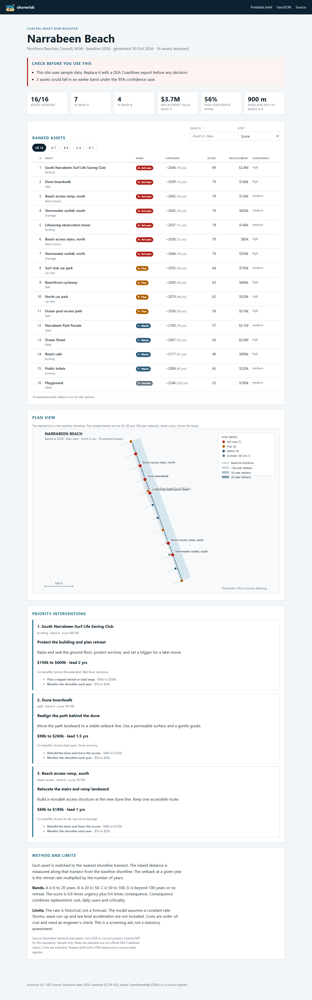
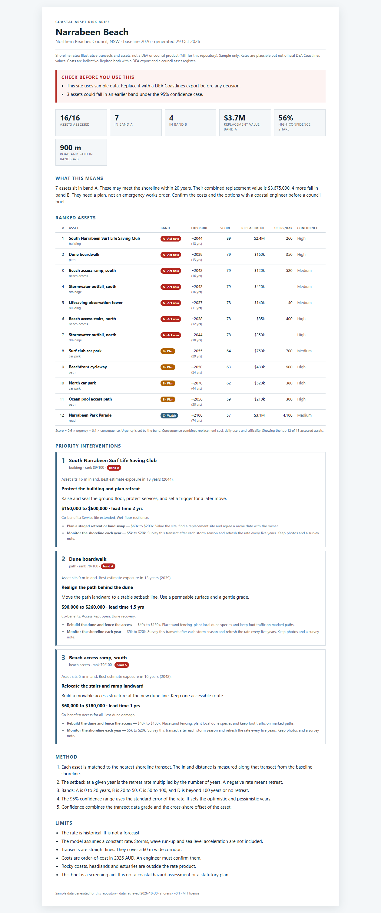

# shorerisk

A coastal asset risk register for councils and community groups. It joins open
shoreline change rates to roads, paths and buildings. It ranks the assets that
will meet the shoreline first. It drafts costed adaptation options for a grant
round.


> **Sample data.** The bundled Narrabeen Beach site is illustrative. Its rates
> are plausible but not official DEA Coastlines values. Its costs are
> indicative. It is not a council assessment. Replace both with a DEA export
> and a council asset register.

## Why this exists

Councils hold asset lists in spreadsheets. DEA Coastlines publishes annual
shoreline positions and change rates at 30 m. The missing layer is the join
between the two. This tool does that join. It reports the year each asset may
become exposed. It ranks the risk and drafts the first intervention list.

## Features

- **Exposure model.** Each asset is projected onto the nearest shoreline
  transect. The tool reports the best, optimistic and pessimistic exposure year
  from the rate and its standard error.
- **Four bands.** A is 0 to 20 years, B is 20 to 50, C is 50 to 100, and D is
  beyond 100 years or no retreat.
- **Risk score.** A 0 to 100 score combines urgency with replacement cost,
  daily users and criticality.
- **Adaptation options.** Each asset class and band maps to ordered options
  with an order-of-cost range, a lead time and co-benefits.
- **Council brief.** A printable one-pager with the ranked table, three
  priority interventions, the method and the limits.
- **Plan drawing.** An SVG plan view with the 20, 50 and 100 year setback
  envelopes.
- **Exports.** GeoJSON for a GIS, and JSON for another tool.
- **Importers.** DEA Coastlines rates and OpenStreetMap assets.
- **Static PWA.** Works offline after the first load. No runtime dependencies.
  No network calls at run time.

## Quick start

Requires Node 20 or later.

```bash
npm install
npm run demo
npm test
```

Build the web app from the sample site:

```bash
npx tsx src/cli.ts build --site data/site-narrabeen.json --out-dir web
npm run serve
```

Open <http://127.0.0.1:8080/>. The printable brief is at `/brief.html`.

Build the CLI:

```bash
npm run build
node dist/cli.js --help
```

## Screenshots



*Ranked assets, band filters and the plan view.*



*The printable council brief.*

## Bring your own data

The tool reads local files. It never calls a network service at run time.

### 1. Export the shoreline rates

Use the DEA Coastlines **rates of change** product. Export a CSV or GeoJSON
subset for your beach. The importer reads these columns:

| Column | Meaning |
| --- | --- |
| `uid` | Point identifier |
| `rate_time` | Rate in metres per year. Negative means retreat |
| `se_time` | Standard error of the rate |
| `sig_time` | p-value of the shoreline trend |
| `valid_obs` | Number of valid annual shorelines |
| `valid_span` | Years between the first and last valid shoreline |
| `lat`, `lon` | Point position. GeoJSON geometry also works |
| `certainty` | Optional source grade: `good`, `ok` or `poor` |

The rate product has one point per 30 m of coast. It has no transect direction.
The importer builds a transect at each point from the local shoreline tangent.
Supply the seaward bearing for your coast. The default is 90 degrees, which is
east.

```bash
npx tsx src/cli.ts import \
  --rates dea-rates.geojson \
  --seaward-bearing 90 \
  --transect-length 200 \
  --out data/rates.json
```

Check the plan drawing after the import. A wrong bearing puts the transects in
the sea.

### 2. Import the assets

Save an Overpass response for your area. Ask for `out center;` so that ways
have a centre point.

```overpassql
[out:json][timeout:60];
(
  way(around:150,-33.7120,151.2955)[highway];
  way(around:150,-33.7120,151.2955)[building];
  node(around:150,-33.7120,151.2955)[amenity=parking];
  node(around:150,-33.7120,151.2955)[man_made=outfall];
);
out center;
```

```bash
npx tsx src/cli.ts import-osm --assets overpass.json --out data/assets.json
```

Imported assets carry a class default cost and are marked as estimates. Replace
the cost with a council figure before you use the brief.

### 3. Combine and build

```bash
npx tsx src/cli.ts combine \
  --transects data/rates.json \
  --assets data/assets.json \
  --id my-beach \
  --name "My Beach" \
  --council "My Council" \
  --state NSW \
  --baseline 2026 \
  --out data/site.json

npx tsx src/cli.ts validate --site data/site.json
npx tsx src/cli.ts build --site data/site.json --out-dir web
```

Edit `data/site.json` to add real costs, user counts and criticality. Run
`validate` again after each edit.

## How the score works

```
erosionBest        = max(0, -rate)
erosionOptimistic  = max(0, -(rate + 1.96 * se))
erosionPessimistic = max(0, -(rate - 1.96 * se))

exposureYear       = inlandDistance / erosion
```

```
costFactor  = clamp(log10(cost / 10_000) / 3, 0, 1)
userFactor  = clamp(log10(users + 1) / log10(5001), 0, 1)
critFactor  = lifeline 1.0, evacuation 0.85, community 0.65, amenity 0.4

consequence = 100 * (0.5 * costFactor + 0.3 * userFactor + 0.2 * critFactor)
urgency     = A 100, B 65, C 35, D 10
score       = round(0.6 * urgency + 0.4 * consequence)
```

The score is a screening aid. It is not a benefit-cost analysis. The brief and
the app both say so.

## CLI

```
shorerisk validate --site FILE
shorerisk model    --site FILE [--baseline YEAR] [--horizon YEARS] [--json]
shorerisk rank     --site FILE [--top N] [--json]
shorerisk brief    --site FILE --out FILE
shorerisk plan     --site FILE --out FILE
shorerisk export   --site FILE --out FILE
shorerisk build    --site FILE --out-dir DIR
shorerisk import   --rates FILE [--seaward-bearing DEG] [--transect-length M] --out FILE
shorerisk import-osm --assets FILE --out FILE
shorerisk combine  --transects FILE --assets FILE --id ID --name NAME --out FILE
shorerisk demo     [--json]
```

Exit codes: `0` ok, `1` runtime error, `2` usage error, `3` data error.

## Data sources

| Source | Use | Access |
| --- | --- | --- |
| [DEA Coastlines](https://knowledge.dea.ga.gov.au/data/product/dea-coastlines/) | Annual shorelines and rates of change at 30 m | Open, CC BY 4.0 |
| [OpenStreetMap](https://www.openstreetmap.org/) via Overpass | Roads, paths, buildings, car parks, outfalls | Open, ODbL |
| Council asset registers | Real replacement cost and user counts | By permission |

The sample site is generated by `scripts/make-sample-site.mjs`. It is marked in
its provenance block, and the app shows a warning when it loads.

## Limits

- The rate is historical. It is not a forecast.
- The model assumes a constant rate. It does not include storms, wave run-up or
  sea level acceleration.
- Transects are straight lines. They cover a 60 m wide corridor.
- Rocky coasts, headlands and estuaries are outside the DEA rate product.
- Costs are order-of-cost in 2026 AUD. An engineer must confirm them.
- The plan drawing is a schematic, not a survey drawing.
- This is a screening tool. It is not a coastal hazard assessment or a
  statutory plan.

## Project layout

```
src/        TypeScript source: geometry, exposure, ranking, adaptation, writers
test/       Node test runner suites
data/       Site files. The bundled one is a marked sample
web/        Static PWA and generated model, brief, plan and GeoJSON
scripts/    Sample site generator, logo renderer, static server
docs/       Logo and screenshots
SPEC.md     Scope, formulas and acceptance criteria
PLAN.md     Build cycles
```

## License

MIT. See [LICENSE](LICENSE).

DEA Coastlines data is CC BY 4.0. OpenStreetMap data is ODbL. Check each
licence before you publish a derived product.